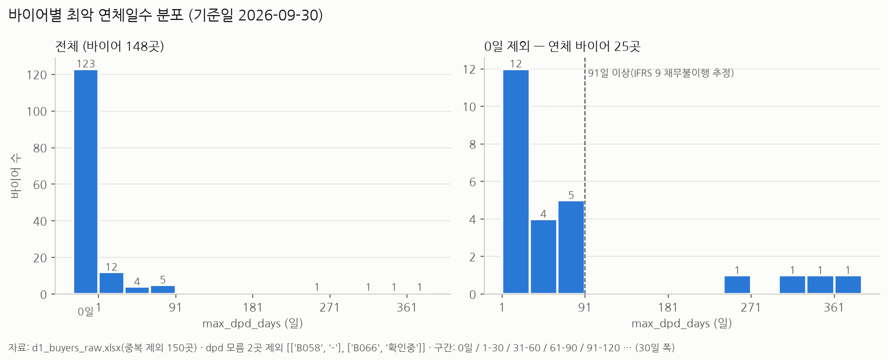
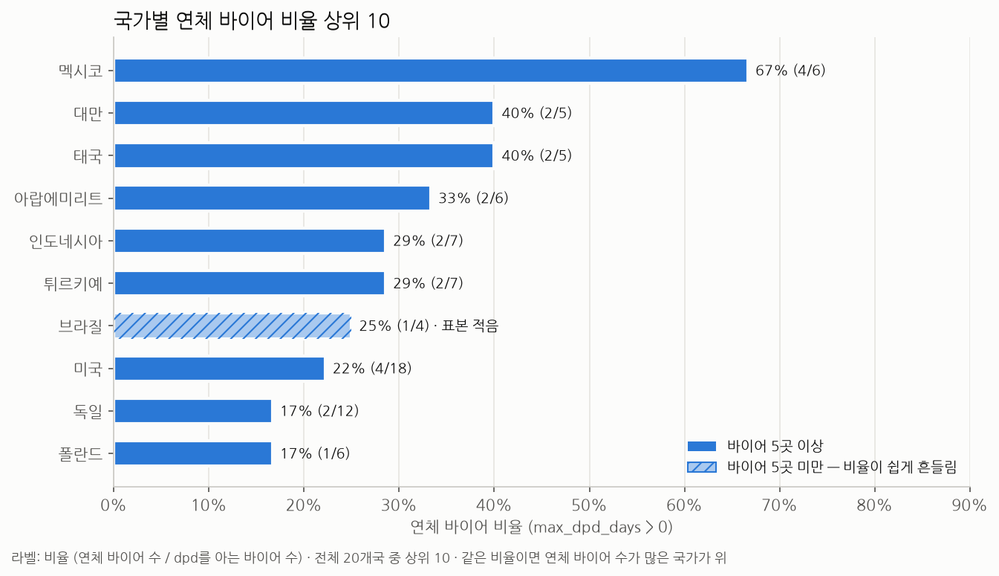
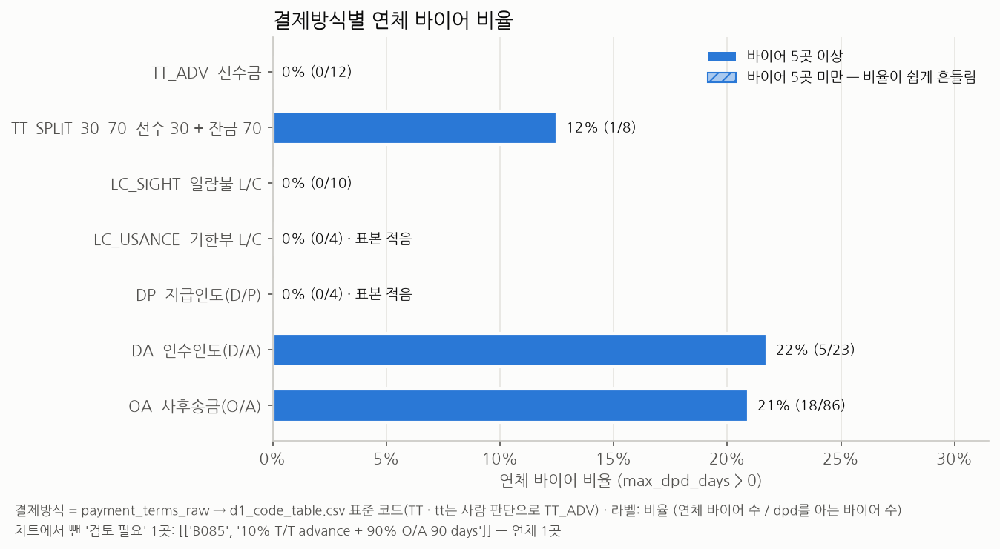

# 1일차 EDA 노트 — 바이어 연체 현황

- 노트북: [workbench/day1/notebooks/d1_eda.ipynb](../notebooks/d1_eda.ipynb) · 정리 규칙과 코드: [scripts/d1_clean_buyers.py](../../../scripts/d1_clean_buyers.py) (R1~R11)
- 원본: `data/day1/d1_buyers_raw.xlsx` (읽기만 했다) · 결제조건 코드: `workbench/day1/outputs/d1_code_table.csv`
- 기준일 2026-09-30 · 원본 153행에서 `buyer_id` 중복 3행을 빼 **150곳**으로 분석했다
- **연체 바이어 = `max_dpd_days > 0`**. 연체일수를 알 수 없는 2곳(B058 `-` · B066 `확인중`)은 비율의 분모에서 뺐다 → 분모 148곳
- 글자로 적힌 연체일수 2건은 숫자만 읽었다(B048 `90일` → 90, B147 `381 days` → 381)

## 결제방식별 바이어 수 · 연체 바이어 수 · 연체 바이어 비율

노트북 셀 5의 출력이다. 연체 바이어 비율 = 연체 바이어 수 ÷ (바이어 수 − dpd 모름).

| 결제방식 | 바이어 수 | dpd 모름 | 연체 바이어 수 | 연체 바이어 비율 (= 연체 ÷ (바이어 − dpd 모름)) |
|---|---:|---:|---:|---:|
| TT_ADV 선수금 | 12 | 0 | 0 | 0.0% (0 ÷ 12) |
| TT_SPLIT_30_70 선수 30 + 잔금 70 | 8 | 0 | 1 | 12.5% (1 ÷ 8) |
| LC_SIGHT 일람불 L/C | 10 | 0 | 0 | 0.0% (0 ÷ 10) |
| LC_USANCE 기한부 L/C | 4 | 0 | 0 | 0.0% (0 ÷ 4) |
| DP 지급인도(D/P) | 4 | 0 | 0 | 0.0% (0 ÷ 4) |
| DA 인수인도(D/A) | 24 | 1 | 5 | 21.7% (5 ÷ 23) |
| OA 사후송금(O/A) | 87 | 1 | 18 | 20.9% (18 ÷ 86) |
| 검토 필요 코드 미정 | 1 | 0 | 1 | 100.0% (1 ÷ 1) |
| **합계** | 150 | 2 | 25 | 16.9% (25 ÷ 148) |

- TT_ADV 12곳에는 사람 판단으로 TT_ADV로 정한 `TT` · `tt` 4곳이 들어 있다.
- LC_USANCE 4곳 중 2곳(`L/C 60 days` · `L/C 90 days`)은 코드표에서 확신이 '낮음'이다.
- '검토 필요' 1곳은 B085(`10% T/T advance + 90% O/A 90 days`)이고, 코드를 아직 정하지 않았다.

## 차트 1 — max_dpd_days 분포

1. 연체일수를 아는 148곳 중 123곳(83.1% = 123 ÷ 148)은 연체가 없고, 연체 바이어는 25곳(16.9% = 25 ÷ 148)이다.
2. 연체 바이어 25곳 중 12곳은 1–30일, 9곳은 31–90일이다. 중앙값은 31일인데 평균은 81일이라, 소수의 장기 연체가 평균을 끌어올린다.
3. 91일 이상은 4곳(B147 태국 DA 381일 · B044 태국 DA 355일 · B083 미국 OA 305일 · B071 대만 OA 269일)이고, 모두 269일 이상이다. 일반적인 지연이 아니라 회수 불능 여부를 개별로 점검해야 할 대상이다.

## 차트 2 — 국가별 연체 바이어 비율 상위 10

전체 평균 연체 비율은 16.9%(25 ÷ 148)다.

1. 멕시코가 67%(4/6)로 가장 높고, 연체 4곳은 모두 OA다(5 · 36 · 48 · 74일). 이어서 대만 · 태국 40%(2/5), 아랍에미리트 33%(2/6) 순이다.
2. 비율보다 연체 길이가 더 큰 문제인 곳이 있다. 태국은 연체 2곳이 모두 DA 장기 연체(355 · 381일)이고, 대만은 1곳이 OA 269일이다.
3. 5곳 미만 표시는 브라질(1/4) 하나뿐이다. 하지만 5곳 이상인 국가도 대부분 5~7곳이라, 바이어 1곳 차이로 비율이 14~20%p(1/7 ~ 1/5) 움직인다. 국가 위험의 근거로 쓰기에는 약하고, 바이어 수가 많은 미국(4/18) · 독일(2/12)이 상대적으로 안정적인 값이다.

## 차트 3 — 결제방식별 연체 바이어 비율

1. 외상 조건인 DA 21.7%(5 ÷ 23)와 OA 20.9%(18 ÷ 86)에만 연체가 몰려 있다. 연체 바이어 25곳 중 23곳이 이 두 방식이다.
2. 선수금(0/12)과 일람불 L/C(0/10)는 연체가 없다. 기한부 L/C와 D/P(각 0/4)도 0이지만 표본이 적다. 선수 30 + 잔금 70은 1곳(B087, 32일)이 연체 중이다.
3. DA는 비율이 OA와 비슷하지만, 91일 이상 장기 연체가 2곳(355 · 381일)으로 23곳 중 2곳이다. OA는 86곳 중 2곳(269 · 305일)이다. 차트에서 뺀 '검토 필요' B085(10% 선수 + 90% O/A 90일)도 22일 연체 중이라 코드를 정해야 한다.

## 한계 · 확인 필요

- 바이어 수가 적어 비율이 쉽게 흔들린다. 국가는 20개국 대부분이 3~7곳이고, 결제방식도 4곳뿐인 코드가 있다.
- `max_dpd_days`는 바이어별 **최악** 연체일수 하나뿐이다. 연체 금액 · 건수의 비중은 이 분석에 들어 있지 않다.
- B058(`-`) · B066(`확인중`)의 실제 연체일수는 원장에서 확인해야 한다.
- 결제방식과 국가가 겹쳐 있다(예: 태국 연체 2곳은 모두 DA). 이 분석은 둘의 영향을 나눠 보지 않았다.
